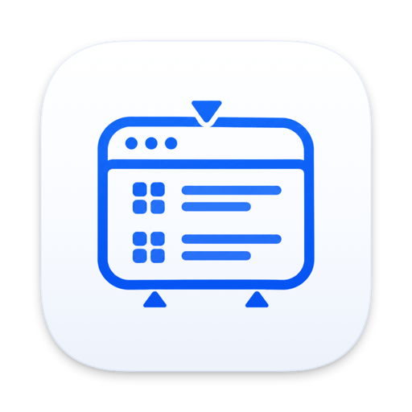
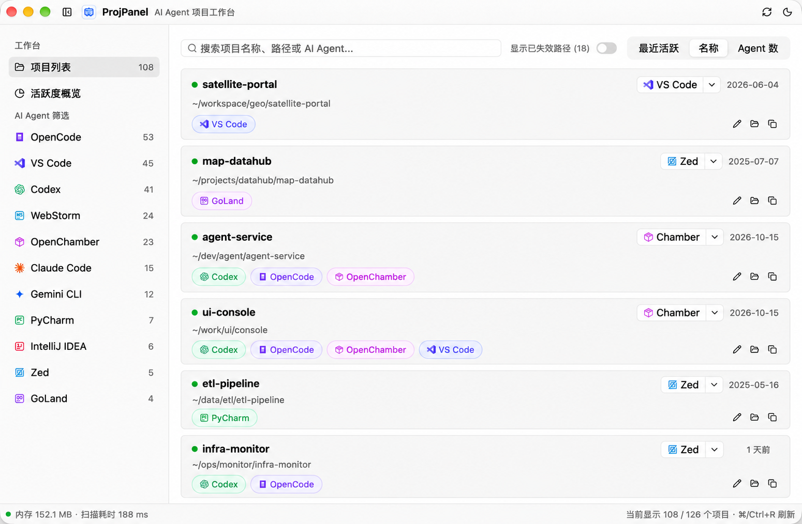

<p align="center">
  
</p>

# ProjPanel

English | [简体中文](README_zh.md)

ProjPanel is a cross-platform desktop workspace and system tray utility built with Rust and [GPUI Kit](https://gpui-kit.com). It automatically gathers projects you've opened with AI agents and editors on your machine.

<p align="center">
  
</p>

## Supported AI Agents and Editors

| Agent / IDE | Data sources |
| --- | --- |
| Claude Code | `~/.claude.json`, `~/.claude/projects/*/*.jsonl` |
| OpenAI Codex | `~/.codex/sessions/**/*.jsonl`, `~/.codex/archived_sessions/**/*.jsonl` |
| Gemini CLI | `~/.gemini/projects.json`, `~/.gemini/trustedFolders.json` |
| OpenCode | `opencode.db` (read-only SQLite), `storage/project/*.json` |
| OpenChamber | `~/.config/openchamber/settings.json`, `projects/*.json`, `sessions-directories.json`, `message-search.sqlite` (read-only SQLite) |
| Zed | The `workspaces` table in `Zed/db/0-stable/db.sqlite` and equivalent databases for other release channels (read-only SQLite) |
| Cursor / Windsurf / VS Code / Trae / Kiro / Antigravity | `User/workspaceStorage/*/workspace.json` for each editor |
| Cline / Roo Code | `User/globalStorage/*/state/taskHistory.json` in VS Code-based editors |
| JetBrains IDEs (IntelliJ IDEA / PyCharm / WebStorm / GoLand / CLion / PhpStorm / Rider / RustRover / RubyMine) | `JetBrains/<Product><Version>/options/recentProjects.xml` (also `recentSolutions.xml` for Rider) |

ProjPanel merges entries with the same normalized project path and keeps each agent's session count, data source, and last activity time.

## Interface Features

- **Desktop window.** Move, resize, or minimize the window and switch between light and dark themes. The window has a custom title bar, a collapsible left sidebar, a main content area, a project details panel on the right, and a status bar at the bottom.
- **GPUI Kit components.** The interface uses `TitleBar`, `Sidebar`, `Input`, `TabBar`, `Button`, `Tag`, `Switch`, `Progress`, `GroupBox`, `Empty`, `StatusBar`, `Notification`, and `ScrollableElement`.
- **System tray and GPUI popover.** After you close the main window, the app stays in the system tray. Left-click the tray icon to search or filter projects by AI agent and open them in your tools with one click. The app destroys the popover and reclaims memory when it loses focus. Right-click the tray icon to reopen the main window, rescan, or quit.

## Usage

```bash
# Open the main window and register the system tray icon
cargo run

# Start in the system tray without opening the main window
cargo run -- --background

# Print scan results for troubleshooting or scripting
cargo run -- --dump
cargo run -- --json

# Package the macOS .app with light and dark icons and Assets.car
./scripts/bundle_macos.sh

# Regenerate light and dark macOS icon assets after updating icon.png
swift scripts/generate_icons.swift
```

## Keyboard Shortcuts

- `Cmd/Ctrl + R` to rescan all AI agents.
- `Esc` while the search field is focused to clear the search.
- `Cmd + Q` to quit the app.

## Adding an Agent Scanner

Add a module under `src/scanner/` that implements the `AgentScanner` trait, then register it in `ScannerRegistry::new()` in `src/scanner/mod.rs`.
