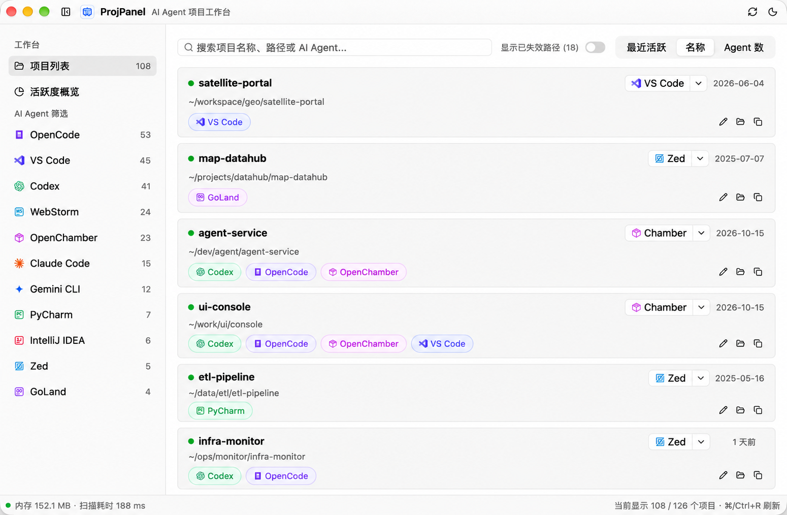

<p align="center">
  
</p>

# ProjPanel

[English](README.md) | 简体中文

基于 Rust + [GPUI Kit](https://gpui-kit.com) 构建的跨平台桌面工作台与系统托盘工具，用于自动读取并汇总本机各类 AI Agent / AI IDE 加载过的项目列表。

<p align="center">
  
</p>

## 已支持的 AI Agent 与编辑器

| Agent / IDE | 读取来源 |
| --- | --- |
| Claude Code | `~/.claude.json`、`~/.claude/projects/*/*.jsonl` |
| OpenAI Codex | `~/.codex/sessions/**/*.jsonl`、`~/.codex/archived_sessions/**/*.jsonl` |
| Gemini CLI | `~/.gemini/projects.json`、`~/.gemini/trustedFolders.json` |
| OpenCode | `opencode.db`（只读 SQLite）、`storage/project/*.json` |
| OpenChamber | `~/.config/openchamber/settings.json`、`projects/*.json`、`sessions-directories.json`、`message-search.sqlite`（只读 SQLite） |
| Zed | `Zed/db/0-stable/db.sqlite` 等通道 `workspaces` 表（只读 SQLite） |
| Cursor / Windsurf / VS Code / Trae / Kiro / Antigravity | 各应用 `User/workspaceStorage/*/workspace.json` |
| Cline / Roo Code | VS Code 系 `User/globalStorage/*/state/taskHistory.json` |
| JetBrains IDE（IntelliJ IDEA / PyCharm / WebStorm / GoLand / CLion / PhpStorm / Rider / RustRover / RubyMine） | `JetBrains/<Product><Version>/options/recentProjects.xml`（Rider 含 `recentSolutions.xml`） |

所有扫描器结果按归一化路径自动去重合并，保留各 Agent 的会话数、数据来源与最近活跃时间。

## 界面特性

- **标准桌面窗口**：带自定义 `TitleBar`、可折叠左侧 `Sidebar`、主内容区、右侧项目详情面板与底部 `StatusBar`，支持拖动、调整尺寸、最小化及亮/暗主题切换。
- **GPUI Kit 组件体系**：全面采用 `TitleBar`、`Sidebar`、`Input`、`TabBar`、`Button`、`Tag`、`Switch`、`Progress`、`GroupBox`、`Empty`、`StatusBar`、`Notification` 与 `ScrollableElement`。
- **托盘常驻与 GPUI 弹出面板**：关闭主窗口后自动驻留系统状态栏，左键点击状态栏图标弹出 GPUI 绘制的快捷项目列表（支持即时搜索、AI Agent 筛选与多工具一键打开），失去焦点后自动销毁弹窗并主动回收进程内存；右键可快速打开主窗口、重新扫描或退出。

## 运行方式

```bash
# 启动桌面主窗口（同时注册系统托盘图标）
cargo run

# 仅在后台状态栏静默启动
cargo run -- --background

# 命令行直接查看扫描与汇总结果（便于排查或脚本集成）
cargo run -- --dump
cargo run -- --json

# 打包 macOS .app 应用（内置亮色 / 暗色 App 图标及 Assets.car）
./scripts/bundle_macos.sh

# 如更新了根目录 icon.png，重新裁剪并生成亮色 / 暗色 macOS 图标资源
swift scripts/generate_icons.swift
```

## 快捷键

- `Cmd/Ctrl + R`：重新扫描所有 AI Agent
- `Esc`（搜索框内）：一键清空搜索条件
- `Cmd + Q`：退出应用

## 扩展新的 Agent 扫描器

在 `src/scanner/` 下新增模块并实现 `AgentScanner` trait，然后在 `src/scanner/mod.rs` 的 `ScannerRegistry::new()` 中注册即可。
